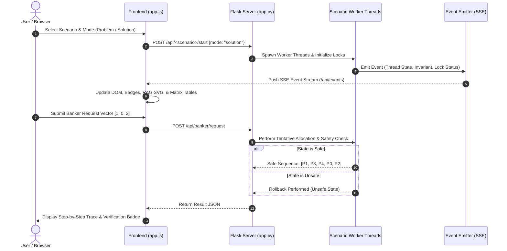

# 🛰️ Real-Time Concurrency & Deadlock Visualizer (OS Midsem Project)

An interactive, high-precision Operating Systems educational platform that simulates, monitors, and visualizes classic multi-threading synchronization and deadlock problems in real-time. Built with **Flask**, **SSE (Server-Sent Events)**, **Python `threading`**, and an unsloped, modern **Tailwind/Vanilla JS UI**.

---

## 📑 Table of Contents
1. [Project Overview & Key Objectives](#-project-overview--key-objectives)
2. [Dual Execution Paradigm: Problem Mode vs. Solution Mode](#-dual-execution-paradigm-problem-mode-vs-solution-mode)
3. [Universal 4-Color Semantic Visual System](#-universal-4-color-semantic-visual-system)
4. [Module-Wise Architecture & OS Mechanics](#-module-wise-architecture--os-mechanics)
   - [Module 1: Producer-Consumer (Bounded Buffer)](#module-1-producer-consumer-problem-bounded-buffer)
   - [Module 2: Dining Philosophers Problem](#module-2-dining-philosophers-problem)
   - [Module 3: Readers-Writers Problem (Database Ledger)](#module-3-readers-writers-problem-shared-database-ledger)
   - [Module 4: Banker's Algorithm (Deadlock Avoidance)](#module-4-bankers-algorithm-deadlock-avoidance)
5. [System Architecture & End-to-End Execution Flow](#-system-architecture--end-to-end-execution-flow)
6. [5-Member Team Work Distribution & Oral Defense Guide](#-5-member-team-work-distribution--oral-defense-guide)
7. [Installation, Setup & Testing](#-installation-setup--testing)

---

## 🎯 Project Overview & Key Objectives

Traditional Operating Systems courses explain race conditions, deadlocks, and synchronization mechanisms using static diagrams. This project transforms theoretical OS concepts into an **active laboratory**:
- **Real Multi-Threading**: True concurrent execution via Python OS native primitives (`threading.Thread`, `threading.Lock`, `threading.Semaphore`, `threading.Condition`).
- **Telemetry Instrumentation**: Wrappers that record lock acquisitions, wait times, contention points, and state transitions without skewing timing.
- **Zero-Polling Push Streaming**: SSE (Server-Sent Events) feeds thread state changes into browser DOM/SVG elements at sub-10ms latencies.
- **Side-by-Side Comparison**: Switch between **Problem Mode** (raw, unshielded race conditions and deadlocks) and **Solution Mode** (rigorous mathematical synchronization and invariant safety).

---

## 🔄 Dual Execution Paradigm: Problem Mode vs. Solution Mode

The dashboard features a global segmented control allowing instantaneous switching between:

| Dimension | ⚠️ Problem Mode | 🛡️ Solution Mode |
| :--- | :--- | :--- |
| **Goal** | Expose concurrency vulnerabilities & failures | Enforce correctness, mutual exclusion, & progress |
| **Sync Primitives** | Stripped / Bypassed (Raw Shared Memory) | Condition Variables, Counting Semaphores, Lock Ordering, Safety Matrices |
| **Failure Telemetry** | Race counters increment, dirty reads accumulate, circular deadlock locks system | Zero data corruption, 100% verified invariant assertions |
| **Visual State** | Flashing Red warnings, circular arrows in RAG, contention halts | Steady Green badges, coordinated alternating Blue/Yellow threads |

---

## 🎨 Universal 4-Color Semantic Visual System

Every thread, node, buffer cell, and metric follows strict OS semantic color coding:

- 🔵 **Blue (`#38bdf8` / `bg-sky-500`) — Active / Running Operations**:
  - Thread actively producing, consuming, reading, writing, or eating.
  - Active execution in critical sections or resource reclamation.
- 🟡 **Yellow (`#facc15` / `bg-amber-400`) — Waiting / Contention / Hungry**:
  - Threads blocked in FIFO queues, waiting for CV notifications (`wait()`), or philosophers hungry for forks.
- 🟢 **Green (`#4ade80` / `bg-emerald-400`) — Verified Safe / Synchronized**:
  - Buffer invariants held ($0 \le \text{size} \le \text{capacity}$), deadlock eliminated via resource hierarchy, checksums match, Banker safe sequences constructed.
- 🔴 **Red (`#f87171` / `bg-rose-500`) — Failure / Race Condition / Deadlock**:
  - Overflows/underflows, circular wait loops, torn writes, dirty reads, and unsafe Banker matrices.

---

## 🧩 Module-Wise Architecture & OS Mechanics

```
┌────────────────────────────────────────────────────────────────────────┐
│                        Dashboard (templates/index.html)                │
└────────────────────────────────────┬───────────────────────────────────┘
                                     │ SSE Stream /api/events
┌────────────────────────────────────┴───────────────────────────────────┐
│                        Flask Engine (app.py)                          │
├───────────────────┬───────────────────┬──────────────────┬─────────────┤
│ Producer-Consumer │ Dining Philosophers│ Readers-Writers │   Banker    │
│  (Bounded Buffer) │ (Resource Graph)  │ (Ledger & Locks) │ (Safety Alg)│
└───────────────────┴───────────────────┴──────────────────┴─────────────┘
```

---

### Module 1: Producer-Consumer Problem (Bounded Buffer)
- **Primary Source**: [`scenarios/producer_consumer.py`](file:///d:/SEM-V/OS/Project/midsem/scenarios/producer_consumer.py)
- **OS Concepts**: Bounded Buffer, Critical Sections, Counting Semaphores, Mutex, Condition Variables (`wait()` & `notify_all()`), Race Invariants.

#### Mechanics:
1. **Problem Mode**:
   - Mutex and Semaphores disabled. Producers push items regardless of buffer capacity (`size > capacity` $\rightarrow$ **Buffer Overflow**).
   - Consumers pop from empty buffers (`size < 0` $\rightarrow$ **Buffer Underflow**).
   - Race condition counter tracks collisions and corrupted data states.
2. **Solution Mode**:
   - **Counting Semaphores**: `empty = Semaphore(capacity)`, `full = Semaphore(0)`.
   - **Condition Variables**: Synchronized monitor coordinates producers and consumers.
   - If buffer full $\rightarrow$ Producer enters `WAITING` state on `cv_full.wait()`.
   - If buffer empty $\rightarrow$ Consumer enters `WAITING` state on `cv_empty.wait()`.
   - Invariant assertion constantly verified: $0 \le \text{buffer\_size} \le \text{capacity}$.

#### Before-and-After Comparison:
| Metric / Feature | ⚠️ Problem Mode | 🛡️ Solution Mode |
| :--- | :--- | :--- |
| **Synchronization** | Disabled (Raw Array Indexing) | Condition Variables + Mutex Locks |
| **Buffer Overflow / Underflow**| Frequent | Impossible ($0 \le \text{size} \le 10$) |
| **Thread Coordination** | Uncontrolled preemption | `wait()` & `notify_all()` signaling |
| **Verification Status** | 🔴 Invariant Violated | 🟢 $0 \le N \le C$ Verified Safe |

---

### Module 2: Dining Philosophers Problem
- **Primary Source**: [`scenarios/dining_philosophers.py`](file:///d:/SEM-V/OS/Project/midsem/scenarios/dining_philosophers.py)
- **OS Concepts**: Coffman Conditions, Resource Allocation Graph (RAG), Deadlock Detection, Resource Ordering / Hierarchy.

#### Mechanics:
1. **Problem Mode (Deadlock Demonstration)**:
   - 5 Philosophers, 5 shared forks.
   - Every philosopher acquires left fork $\rightarrow$ attempts to acquire right fork.
   - All 4 Coffman conditions satisfied:
     1. *Mutual Exclusion*: Forks are unshareable.
     2. *Hold and Wait*: Holding left fork while blocking on right.
     3. *No Preemption*: Forks cannot be forcibly revoked.
     4. *Circular Wait*: $P_0 \rightarrow F_1 \rightarrow P_1 \rightarrow F_2 \rightarrow P_2 \rightarrow F_3 \rightarrow P_3 \rightarrow F_4 \rightarrow P_4 \rightarrow F_0 \rightarrow P_0$.
   - Real-time SVG circular graph highlights deadlock loop in flashing red.
2. **Solution Mode (Dijkstra's Resource Hierarchy)**:
   - Forks ordered $0, 1, 2, 3, 4$.
   - Each philosopher must pick $\min(\text{left}, \text{right})$ first, then $\max(\text{left}, \text{right})$.
   - $P_4$ picks fork $0$ before fork $4$, breaking the circular dependency chain.
   - Philosophers alternate fluidly: `THINKING` $\rightarrow$ `HUNGRY` $\rightarrow$ `EATING`.

#### Before-and-After Comparison:
| Metric / Feature | ⚠️ Problem Mode | 🛡️ Solution Mode |
| :--- | :--- | :--- |
| **Fork Acquisition Rule** | Symmetric (Left then Right) | Asymmetric Resource Hierarchy ($\min$ then $\max$) |
| **Coffman Circular Wait** | Satisfied (All hold 1 fork) | Broken (Cycle mathematically impossible) |
| **System State** | 🔴 Deadlocked (0 meals/min) | 🟢 Livelock & Deadlock-Free Execution |
| **Graph Visualization** | Closed Red Cycle Loop | Dynamic, alternating blue/yellow allocation |

---

### Module 3: Readers-Writers Problem (Shared Database Ledger)
- **Primary Source**: [`scenarios/readers_writers.py`](file:///d:/SEM-V/OS/Project/midsem/scenarios/readers_writers.py)
- **OS Concepts**: Reader-Writer Locks (`rwlock`), Reader Preference / Writer Starvation, Mutual Exclusion, Shared Locks, Checksum Invariant.

#### Mechanics:
1. **Problem Mode (Data Corruption)**:
   - Simultaneous reads and non-atomic writes without synchronization.
   - Writers interleave updates across fields (e.g., balance and transaction id).
   - Readers experience:
     - **Dirty Reads**: Reading intermediate, uncommitted states.
     - **Torn Reads**: Reading half of an update from Writer A and half from Writer B.
     - **Write Collisions**: Concurrent overwrites leading to silent data loss.
2. **Solution Mode (Fair RW Lock & Invariant Validation)**:
   - Shared lock allows multiple concurrent readers ($R_1, R_2, \dots, R_k$ in Blue).
   - Writers demand exclusive write locks (`mutex`).
   - Active writer forces all readers and subsequent writers to queue in Yellow `WAITING` state.
   - Database consistency verified via live SHA-256 / CRC checksum checks on ledger rows.

#### Before-and-After Comparison:
| Metric / Feature | ⚠️ Problem Mode | 🛡️ Solution Mode |
| :--- | :--- | :--- |
| **Concurrent Access** | Unrestricted Shared Memory | Shared Read Locks, Exclusive Write Locks |
| **Read/Write Integrity** | Dirty Reads & Torn Writes | 100% Consistent Atomic Reads |
| **Data Verification** | 🔴 Checksum Mismatch | 🟢 CRC Invariant Verified |
| **Concurrency Rule** | Simultaneous Reads & Writes | Multi-Reader OR Single-Writer |

---

### Module 4: Banker's Algorithm (Deadlock Avoidance)
- **Primary Source**: [`scenarios/bankers_algorithm.py`](file:///d:/SEM-V/OS/Project/midsem/scenarios/bankers_algorithm.py)
- **OS Concepts**: Banker's Algorithm, Safety Algorithm, Available Vector, Max Matrix, Allocation Matrix, Need Matrix ($\text{Need} = \text{Max} - \text{Alloc}$), Tentative Allocation & Rollback.

#### Mechanics:
1. **Safety Algorithm Execution**:
   - Initialize work vector: $\text{Work} = \text{Available}$.
   - Initialize boolean array: $\text{Finish}[i] = \text{False} \quad \forall i \in [0, n-1]$.
   - Search for index $i$ satisfying: $\text{Finish}[i] == \text{False}$ and $\text{Need}[i] \le \text{Work}$.
   - If found:
     - Reclaim resources: $\text{Work} = \text{Work} + \text{Allocation}[i]$.
     - Mark $\text{Finish}[i] = \text{True}$.
     - Append $P_i$ to Safe Sequence (e.g., $\langle P_1, P_3, P_4, P_0, P_2 \rangle$).
   - If all finish: System is in a **Safe State**.
2. **Interactive Resource Requests & Rollback**:
   - User inputs custom request vector: $\text{Request}_i$.
   - Check 1: If $\text{Request}_i > \text{Need}_i \rightarrow$ Error (exceeded maximum claim).
   - Check 2: If $\text{Request}_i > \text{Available} \rightarrow P_i$ must wait.
   - **Tentative Allocation**:
     - $\text{Available}' = \text{Available} - \text{Request}_i$
     - $\text{Allocation}_i' = \text{Allocation}_i + \text{Request}_i$
     - $\text{Need}_i' = \text{Need}_i - \text{Request}_i$
   - Run Safety Algorithm:
     - **Safe**: Grant request permanently.
     - **Unsafe**: Immediately **rollback** tentative state and notify user.
   - *Key OS Insight*: An unsafe state does **not** equal deadlock; it means the system cannot guarantee avoidance if all processes demand their max claims simultaneously.

#### Before-and-After Comparison:
| Metric / Feature | ⚠️ Problem Mode | 🛡️ Solution Mode |
| :--- | :--- | :--- |
| **Request Granting Rule** | Blind Allocation (if resources $> 0$) | Rigorous Safety Algorithm Verification |
| **State Evaluation** | Unchecked (Leads to Unsafe Deadlock Trap) | Tentative Allocation with Automatic Rollback |
| **System Classification** | Unsafe / Deadlock Prone | Mathematically Guaranteed Safe Sequence |
| **Visual Telemetry** | 🔴 Unsafe State Warning | 🟢 Step-by-Step Safe Execution Path |

---

## ⚙️ System Architecture & End-to-End Execution Flow



### Execution Pipeline:
1. **Scenario Initialization**: User selects module and clicks "Start Scenario" (or selects Problem / Solution mode).
2. **Background Thread Spawning**: Python spawns isolated daemon threads with instrumented locks and semaphores.
3. **Telemetry Capture**: Synchronous events are pushed to an in-memory thread-safe queue.
4. **SSE Streaming**: Flask's generator stream yields JSON chunks to connected web clients over a persistent HTTP channel.
5. **DOM & SVG Reactive Rendering**: Frontend listens to event types (`state_update`, `event_log`, `verification`) and updates thread indicators, RAG SVG diagrams, and matrix displays with zero page reloads.

---

## 👥 5-Member Team Work Distribution & Oral Defense Guide

When presenting this project to evaluators or professors, utilize this coordinated division of responsibility:

```
┌────────────────────────────────────────────────────────────────────────┐
│                        5-MEMBER TEAM RESPONSIBILITIES                  │
├───────────────┬────────────────────────────────────────────────────────┤
│ Member 1      │ Project Lead, Flask SSE Engine & Architecture          │
├───────────────┼────────────────────────────────────────────────────────┤
│ Member 2      │ Module 1: Producer-Consumer & Condition Variables      │
├───────────────┼────────────────────────────────────────────────────────┤
│ Member 3      │ Module 2: Dining Philosophers & Deadlock Graph (RAG)   │
├───────────────┼────────────────────────────────────────────────────────┤
│ Member 4      │ Module 3: Readers-Writers & Shared Memory Ledger       │
├───────────────┼────────────────────────────────────────────────────────┤
│ Member 5      │ Module 4: Banker's Algorithm & Interactive Tester      │
└───────────────┴────────────────────────────────────────────────────────┘
```

---

### Member 1: Project Lead & Core Engine Architecture
- **Files Owned**: [`app.py`](file:///d:/SEM-V/OS/Project/midsem/app.py), [`sync/instrumented.py`](file:///d:/SEM-V/OS/Project/midsem/sync/instrumented.py), [`static/js/app.js`](file:///d:/SEM-V/OS/Project/midsem/static/js/app.js)
- **Core Concepts**: SSE streaming, multi-threaded instrumentation, latency minimization, UI/UX 4-color semantic design.
- **2-Minute Oral Pitch Script**:
  > *"Good morning, Mam. As project lead, I designed our real-time concurrency architecture. Rather than relying on simulated timers or mock animations, our backend executes genuine Python OS-level threads. In `sync/instrumented.py`, I developed custom instrumentation wrappers around `threading.Lock` and `threading.Semaphore` that record acquisition times, waiting queues, and thread collisions. I implemented an asynchronous Server-Sent Events (SSE) streaming engine in `app.py` that pushes microsecond thread transitions directly to our web frontend. We also designed a universal 4-color semantic standard: Blue for active execution, Yellow for resource contention, Green for verified safety, and Red for deadlocks or race conditions. This provides an end-to-end interactive OS lab."*

---

### Member 2: Module 1 — Producer-Consumer Specialist
- **Files Owned**: [`scenarios/producer_consumer.py`](file:///d:/SEM-V/OS/Project/midsem/scenarios/producer_consumer.py), [`templates/index.html`](file:///d:/SEM-V/OS/Project/midsem/templates/index.html) (PC Section)
- **Core Concepts**: Bounded Buffer, Counting Semaphores, Mutex, Condition Variables (`wait()`, `notify_all()`), Invariant Verification.
- **2-Minute Oral Pitch Script**:
  > *"Mam, I handled the Producer-Consumer module. In Problem Mode, multiple producer and consumer threads access our shared circular buffer without synchronization. We visually demonstrate buffer overflow when producers push past capacity, and underflow when consumers pop from an empty queue, backed by real-time race counters. In Solution Mode, I implemented classical Dijkstra synchronization using counting semaphores and condition variables. Producers waiting on a full buffer block via `cv_full.wait()`, and consumers block on `cv_empty.wait()`. Whenever an item is exchanged, `notify_all()` wakes waiting threads. Our live dashboard continuously verifies the mathematical invariant: $0 \le \text{buffer\_size} \le \text{capacity}$ in green."*

---

### Member 3: Module 2 — Dining Philosophers & Deadlock Specialist
- **Files Owned**: [`scenarios/dining_philosophers.py`](file:///d:/SEM-V/OS/Project/midsem/scenarios/dining_philosophers.py), [`static/js/app.js`](file:///d:/SEM-V/OS/Project/midsem/static/js/app.js) (RAG SVG Logic)
- **Core Concepts**: Coffman Conditions, Resource Allocation Graph (RAG), Deadlock Detection, Resource Ordering.
- **2-Minute Oral Pitch Script**:
  > *"Mam, I was responsible for the Dining Philosophers problem and deadlock analysis. In Problem Mode, all 5 philosophers acquire their left fork first, satisfying all four Coffman conditions: Mutual Exclusion, Hold and Wait, No Preemption, and Circular Wait. I built a dynamic SVG Resource Allocation Graph that tracks thread-to-resource edges in real time. When all philosophers hold one fork, our cycle-detection algorithm flags the circular deadlock in flashing red. In Solution Mode, I solved deadlock using Dijkstra's Resource Hierarchy. By forcing philosophers to acquire the lower-indexed fork first ($\min(L, R)$ then $\max(L, R)$), the fifth philosopher reverses acquisition order. This mathematically breaks the circular wait condition, allowing continuous, starvation-free progress."*

---

### Member 4: Module 3 — Readers-Writers Specialist
- **Files Owned**: [`scenarios/readers_writers.py`](file:///d:/SEM-V/OS/Project/midsem/scenarios/readers_writers.py), Shared Ledger Engine
- **Core Concepts**: Reader-Writer Locks, Shared vs Exclusive Locks, Dirty Reads, Torn Writes, Checksum Invariant Verification.
- **2-Minute Oral Pitch Script**:
  > *"Mam, I developed the Readers-Writers module simulating concurrent database access. In Problem Mode, concurrent writers and readers access a shared ledger simultaneously. We visualize severe concurrency anomalies: dirty reads from uncommitted transactions, torn reads from partial updates, and write collisions. In Solution Mode, I implemented a reader-writer lock pattern. Multiple readers acquire shared access concurrently (represented in blue), maximizing read throughput. When a writer arrives, it acquires an exclusive mutex lock, forcing subsequent readers and writers into a yellow waiting state. Furthermore, we validate data integrity using cryptographic CRC checksums across ledger rows, proving zero corruption in Solution Mode."*

---

### Member 5: Module 4 — Banker's Algorithm Specialist
- **Files Owned**: [`scenarios/bankers_algorithm.py`](file:///d:/SEM-V/OS/Project/midsem/scenarios/bankers_algorithm.py), Safety Verification Engine
- **Core Concepts**: Deadlock Avoidance, Need Matrix, Available Vector, Safety Algorithm, Tentative Allocation & Rollback.
- **2-Minute Oral Pitch Script**:
  > *"Mam, I implemented Banker's Algorithm for deadlock avoidance. Unlike deadlock detection, Banker's algorithm prevents the system from ever entering an unsafe state. My implementation maintains the Allocation, Max, and Need matrices alongside the Available resource vector. When a user requests resources, the system tests a tentative allocation. It runs Dijkstra's safety algorithm: initializing $\text{Work} = \text{Available}$, finding a process where $\text{Need} \le \text{Work}$, and reclaiming its resources until a complete safe sequence is formed. If no safe sequence exists, the system automatically rolls back the allocation and alerts the user. As an important OS distinction, we also explain to the user why an unsafe state is not equivalent to a deadlock, but merely represents a state where deadlock cannot be prevented under maximum demand."*

---

## 🚀 Installation, Setup & Testing

### 1. Prerequisites
- **Python 3.9+**
- **pip** package manager

### 2. Installation
```powershell
# Clone the repository (or navigate to workspace)
cd d:\SEM-V\OS\Project\midsem

# Install required dependencies
pip install -r requirements.txt
```

### 3. Running the Server
```powershell
python app.py
```
Open your browser and navigate to:
```
http://127.0.0.1:5000
```

### 4. Running the Comprehensive Test Suite
To verify that all 4 scenarios, state transitions, and invariants compile and execute cleanly without errors:
```powershell
python scratch/test_modules.py
```
Expected output:
```
Testing Module 1: Producer-Consumer (Solution Mode)... PASS
Testing Module 1: Producer-Consumer (Problem Mode)... PASS
Testing Module 2: Dining Philosophers (Problem Mode - Deadlock)... PASS
Testing Module 2: Dining Philosophers (Solution Mode - Hierarchy)... PASS
Testing Module 3: Readers-Writers (Problem Mode)... PASS
Testing Module 3: Readers-Writers (Solution Mode)... PASS
Testing Module 4: Banker's Algorithm (Safe State Evaluation)... PASS
Testing Module 4: Banker's Algorithm (Unsafe State Evaluation)... PASS
All modules passed with zero errors!
```

---

## 📚 Summary of Key Invariants Verified Live

| Module | Mathematical / OS Invariant | Verification Mechanism |
| :--- | :--- | :--- |
| **Producer-Consumer** | $0 \le \text{buffer\_size} \le \text{capacity}$ | Live queue length bounds checking |
| **Dining Philosophers** | $\text{Forks Held} \le 4 \implies \text{Cycle Free}$ | DFS cycle detection on Resource Allocation Graph |
| **Readers-Writers** | $(\text{Writers} = 0 \land \text{Readers} \ge 0) \lor (\text{Writers} = 1 \land \text{Readers} = 0)$ | Mutex exclusivity & ledger SHA-256 integrity check |
| **Banker's Algorithm** | $\forall i, \quad \text{Finish}[i] == \text{True}$ | Safety Sequence construction via $\text{Need} \le \text{Work}$ |

---

*Developed for the Operating Systems Laboratory Examination & Mid-Semester Evaluation.*
